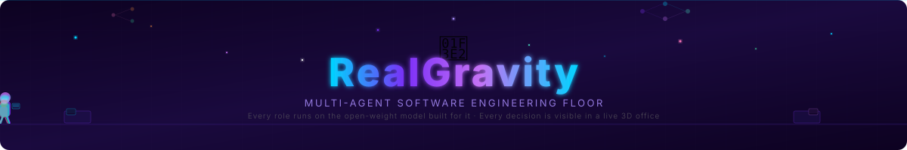
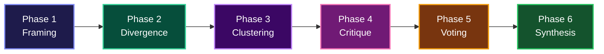
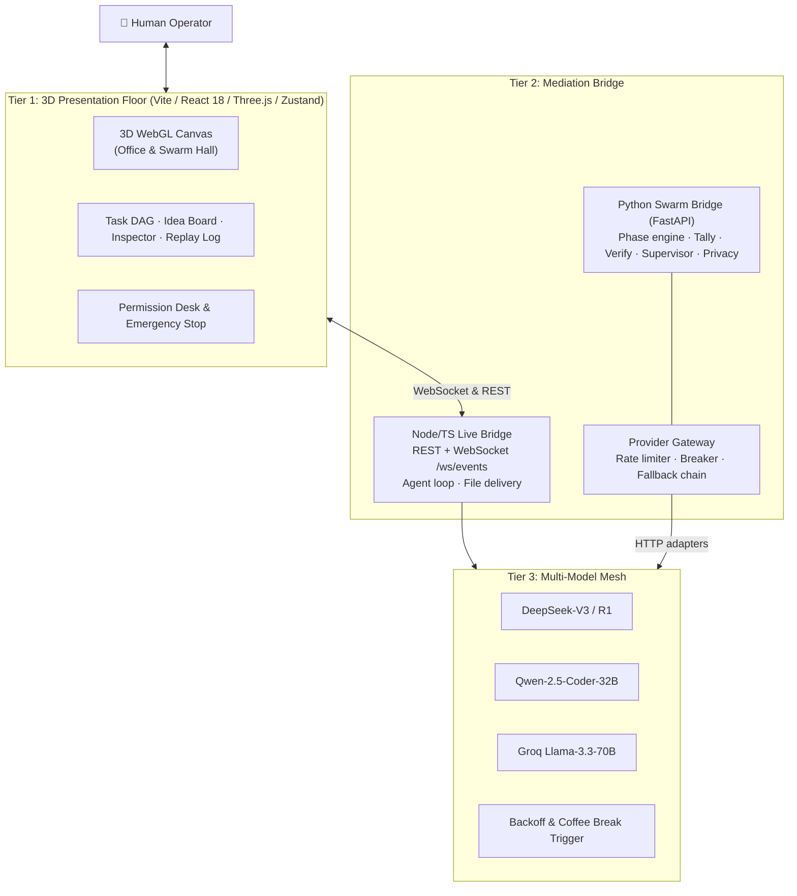
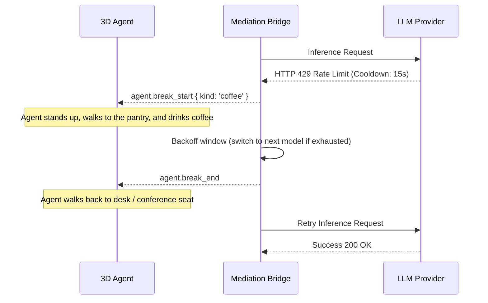

<!-- Animated Header with Walking AI Agents -->
<p align="center">
  
</p>

<!-- Hero Banner -->
<p align="center">
  
</p>

<!-- Badges -->
<p align="center">
  <a href="#"></a>
  <a href="#"></a>
  <a href="#"></a>
  <a href="#"></a>
  <a href="#"></a>
</p>

<p align="center">
  <a href="#"></a>
  <a href="#"></a>
  <a href="#"></a>
  <a href="#"></a>
  <a href="#"></a>
  <a href="#"></a>
  <a href="#"></a>
</p>

---

### A spatially-grounded, multi-agent autonomous engineering simulation where specialized AI agents plan, debate in swarms, cross-examine architectures, and deliver code inside an observable real-time 3D workspace.

---

## ⚡ Core Highlights

- **Dual-Engine Workflows:** Switch between **Deskmates Virtual Office** (manager + backend, frontend and QA engineers) and **Swarm Hall** (10, 20, 30, 40 or 50 agents at a grand oval conference table).
- **Live LLM Execution:** In live mode, plans, proposals, critiques, votes and code deliverables are generated from your prompt through a multi-provider fallback chain (**DeepSeek-V3 / R1, Qwen-2.5-Coder, Llama-3.3-70B** via OpenRouter, DeepSeek direct, or Groq).
- **Real Tool-Using Agents:** Agents read files and PDFs, write code to disk, run shell commands and execute tests, every action gated by a permission request.
- **Visual Rate-Limit Backoff (Coffee Breaks):** On HTTP 429, the affected agent walks to the pantry, waits out the cooldown, and the bridge auto-switches to the next model in the chain.
- **Human-in-the-Loop Safety:** Permission modals for `file.read`, `file.write` and `shell.exec` (approve once / always / reject), plus an instant **Emergency Stop** that broadcasts `system.halted`.
- **Deep Reasoning Preservation:** 65-second request window so DeepSeek-R1 can finish its chain-of-thought before the response is cut.
- **Replayable Event Stream:** Monotonic, seq-tracked WebSocket events with `since_seq` resume. Reconnects produce zero duplicate and zero missing events (tested).
- **Exportable Reports:** Final report view with PDF export (jsPDF), project bundle download (JSZip), and one-click git merge / discard of the agent branch.

---

## ✅ Implementation Status

| Area | Status | Details |
|---|---|---|
| 3D Office floor (14 zones, A* nav, door queues, wall sliding) | ✅ Done | Procedural low-poly agents, collision-free movement (tested), day/night, blueprint view, minimap |
| 3D Swarm Hall (oval table, inward seating, Idea Board) | ✅ Done | 10-50 agents, collision-free entrance simulation tested at n=10 and n=50 |
| Triage layer (task type + complexity → right-sized team) | ✅ Done | Solo manager, small team, or full department hire, driven by task kind and size |
| Event contract (36 event types, REST + WS) | ✅ Done | Documented in `frontend/docs/api-contract.md`, verified by a live-contract test |
| Live bridge (Node/TS) with real LLM calls | ✅ Done | Task planning, multi-file generation, tests, report, permission round-trips |
| Agent tool loop (`read_file`, `write_file`, `list_dir`, `execute_command`) | ✅ Done | Permission-gated, PDF/doc extraction helpers in Python |
| Swarm Hall live run | ✅ Done | Proposals, critiques, weighted Borda voting, agreement % and final synthesis all run on live LLM calls through the Python engine |
| Provider Gateway (Python) | ✅ Done | Token bucket, TPM window, priority queue with aging, AIMD on 429, circuit breaker, fallback chain. 16 tests |
| Swarm Engine (Python / FastAPI) | ✅ Done | Full 6-phase engine, real Borda tally, clustering, verification, supervisor, privacy firewall. 29 tests. Wired to live provider adapters |
| Real provider HTTP adapters in the Python gateway | ✅ Done | OpenRouter, DeepSeek and Groq adapters run behind the gateway's rate limiter, breaker and fallback chain |
| RealGravity / PAG terminal agent (`backend/`) | ✅ Done | Docker sandbox, `strict` / `assist` / `turbo` profiles, egress allowlist, eval harness |
| Git merge / discard from the UI report | ✅ Done | Report buttons merge or discard the `agent/<timestamp>` branch |

---

## 🏛️ Dual Working Modalities

### 1. Deskmates Office Mode (Collaborative Sprint Execution)
Designed for iterative feature development, bug fixing and test-driven work:
- 👩‍💼 **Diya (Lead Manager):** Goal triage, task planning, glass-walled executive cabin and real-time operator chat.
- 👨‍💻 **Rohan (Backend Engineer):** APIs, schemas and system logic.
- 🎨 **Kabir (Frontend Engineer):** Component architecture, UI/UX and styling.
- 🧪 **Nisha (QA & Test Architect):** Edge cases, unit tests and acceptance verification.

**What you can do in the office:**
- Click any agent for the **Inspector** (status, task progress, energy, context meter, engine, live terminal/diff, follow-cam).
- Track work in the left panel: **org chart, task DAG and blackboard**.
- Watch the **event log with replay scrubber**, the **Compute & Cost drawer**, and the **Permission Desk**.
- Rank is visible by clothing: workers wear their department color, leads wear a deeper shade with a lanyard, the manager wears a suit and tie.
- Pantry, cafeteria, three meeting rooms, lounge and a server room that blinks on real LLM calls. Breaks are slow because walking is real.
- Keyboard: `Space` pause · `F` follow · `G` flows · `B` blueprint · `D` dev overlay · `Esc` close.

### 2. Swarm Hall Mode (Massive Consensus Synthesis)
Designed for high-stakes architectural synthesis and system design:
- **Amphitheater Seating:** 10, 20, 30, 40 or 50 agents seated around the central oval table.
- **10 Persona Roles:** Strategist, Skeptic, Domain Expert, Creative, Pragmatist, Risk Analyst, User Advocate, Fact-Checker, Engineer, Economist.
- **Idea Board:** Proposals and clusters appear live in 3D with per-cluster vote counts.
- **Output:** Multi-file projects are written to `output/<ProjectSlug>/`.

---

## 🔄 The 6-Phase Swarm Consensus Protocol



1. **Framing:** Moderator Diya deconstructs the prompt into constraints and architectural vectors.
2. **Divergence:** Agents draft independent proposals without seeing each other's output, which limits early bias.
3. **Clustering:** Proposals are grouped into design archetypes (similarity threshold `τ = 0.55`, up to 8 clusters, outlier tray for singletons).
4. **Adversarial Critique:** Each cluster is cross-examined with `SUPPORT` vs `CHALLENGE` stances. A solver assigns critics so no one reviews their own cluster, with a minimum number of critics, personas and model families.
5. **Weighted Borda Voting:** Ranked top-3 ballots (3/2/1 points), anonymized and shuffled, with reliability-weight clamping, a **veto rule** and **early-decision** detection once the margin is unassailable.
6. **Synthesis & Verification:** Multi-file code generation, checked by the L0-L3 pipeline before delivery.

**Verification pipeline (Python engine):**

| Level | Check | Gate |
|---|---|---|
| L0 | Syntax, write-set scope, clean apply | Hard |
| L1 | Lint, secret scan on the diff | Hard |
| L2 | Contract acceptance tests | Hard |
| L3 | Cross-examination tests | Scored |

**Supervision:** Deterministic zero-token watchdogs detect stalls, duplicate output, scope violations and budget burn. A supervisor arbiter handles escalation. Operators can `pause`, `resume`, `cancel`, `hint`, `kill_agent`, `raise_n_cell` or `reduce_active` mid-run.

---

## 🏗️ System Architecture



---

## ☕ Visual Rate-Limit Backoff (Coffee Breaks)



---

## 🔐 Safety & Privacy

**Permission Gate (live bridge):**
- `file.read`, `file.write` and `shell.exec` each raise a `permission.requested` event and block the agent until the operator answers `once`, `always` or `reject`.
- **Emergency Stop** (`POST /api/system/stop`) rejects every pending permission, marks runs done, returns all agents to IDLE and broadcasts `system.halted`.

**Egress Firewall (Python swarm engine):**
- Single choke point for outbound payloads with a provider **trust registry** and privacy modes.
- Local file classifier labels files `restricted` / `internal` / `public` (`.env*`, keys, certs and credentials are restricted by default).
- Secret and PII **redaction**, **pseudonymization**, payload minimization, **canary token** leak detection and a local audit log.

**RealGravity / PAG Sandbox (`backend/`):**
- Docker-isolated agent with an nginx key-injecting LLM proxy (keys never enter the container), a Squid egress allowlist, and private SearXNG search.
- Three profiles: `strict` (asks before every edit), `assist` (default), `turbo` (auto-pilot on clean repos). `sudo`, `rm -rf`, `git push`, `ssh`, `scp` and `git reset --hard` are always denied.
- Agent work lands on a throwaway `agent/<timestamp>` git branch with a live audit pane and live diff pane.

---

## 🧰 Provider Gateway

Implemented in `bridge/deskmates_bridge/gateway/` and covered by 16 tests:

- Real HTTP adapters for OpenRouter, DeepSeek and Groq
- Token-bucket limiter with safety margin and a sliding **TPM window**
- Priority queue with **aging** (no starvation), per-lane and global concurrency caps
- `429` / `Retry-After` handling with **AIMD** backoff
- `5xx` retry → **fallback chain**, context-length-aware routing (an over-context request is never sent to an 8k model)
- **Circuit breaker** (open / half-open / close) and auth-dead provider detection that never echoes keys
- Token estimator that learns from usage
- Load test: 50 concurrent requests at 20 rpm produce **zero provider 429s**

---

## 🚀 Quick Start Guide

### 1. Prerequisites
- **Node.js** 20+ & **npm** 10+
- *(Optional, for live mode)* an API key for OpenRouter, DeepSeek or Groq
- *(Optional, for the Python swarm engine)* Python 3.11+

### 2. Setup
```bash
git clone https://github.com/bhalerao-aditya007/RealGravity_slayers.git
cd RealGravity_slayers

# Environment variables
cp .env.example .env
# Add at least one key to .env (live mode only):
# OPENROUTER_API_KEY=sk-or-v1-...
# GROQ_API_KEY=gsk_...
# DEEPSEEK_API_KEY=...

# Install frontend dependencies
cd frontend
npm install
```

### 3. Run in Demo Mode (no keys needed)
```bash
cd frontend
npm run dev
```
Open `http://localhost:5173`, pick **Office** or **Swarm** mode, choose a task chip and enter the floor. Everything runs client-side with a synthetic simulator.

### 4. Run in Live Mode (real LLMs)
**Terminal 1 (Bridge):**
```bash
cd frontend
npm run bridge:mock      # REST + WebSocket on :8000
```

**Terminal 2 (3D Floor):**
```bash
cd frontend
echo "VITE_USE_MOCK=false" > .env.local
npm run dev
```

> On Windows, `scripts/start-all.ps1` launches both together.
> **Note:** the live runner currently writes deliverables under a hard-coded `D:\GravityDesk\output` path. Change it in `frontend/tools/mock-bridge/realRunner.ts` if your checkout lives elsewhere.

### 5. Run the Python Swarm Engine
```bash
cd bridge
pip install -e ".[dev]"
uvicorn deskmates_bridge.main:app --port 8001
```
Exposes `/api/swarm/estimate`, `/api/swarm/{run_id}/admission`, `/consent`, `/steer`, `/board`, `/egress`, `/phase`, `/ideas`, `/api/providers/health` and `/ws/events`. Provider keys are read from the same `.env`.

### 6. Run the RealGravity Terminal Agent
```bash
cd backend
cp .env.example .env && chmod 600 .env
./scripts/preflight.sh
./bin/pag /path/to/project assist
```
See [`backend/README.md`](backend/README.md) for profiles, model switching and key rotation.

---

## 🧪 Automated Test Suite

**Frontend (Vitest): 40 tests across 9 files**
```bash
cd frontend
npm test
```
```
 ✓ src/tests/integration.test.ts     (4 tests)
 ✓ src/tests/triage.test.ts         (10 tests)
 ✓ src/tests/live-contract.test.ts   (4 tests)   WebSocket resume, permission round-trip
 ✓ src/tests/swarmTape.test.ts       (3 tests)
 ✓ src/tests/swarmEntrance.test.ts   (2 tests)   n=10 and n=50, collision-free
 ✓ src/tests/stress.test.ts          (1 test)
 ✓ src/tests/swarmLayout.test.ts    (10 tests)
 ✓ src/tests/nav.test.ts             (3 tests)
 ✓ src/tests/layout.test.ts          (3 tests)

 Test Files  9 passed (9)
      Tests  40 passed (40)
```

**Bridge (Pytest): 45 tests**
```bash
cd bridge
python -m pytest -q
```
```
 tests/gateway/test_gateway.py                          16 passed
 tests/swarm/test_privacy_and_egress.py                  5 passed
 tests/swarm/test_admission_and_estimator.py             4 passed
 tests/swarm/test_bus_and_phase_engine.py                3 passed
 tests/swarm/test_verifier_and_crossexam.py              3 passed
 tests/swarm/test_watchdogs_and_supervisor.py            3 passed
 tests/swarm/test_chaos_and_degradation.py               2 passed
 tests/swarm/test_clustering_and_assign.py               2 passed
 tests/swarm/test_controller_and_round_flow.py           2 passed
 tests/swarm/test_personas_and_distinctness.py           2 passed
 tests/swarm/test_tally_and_early_decision.py            2 passed
 tests/swarm/test_eval_harness.py                        1 passed

 45 passed
```

---

## 📁 Repository Layout

| Path | What lives there |
|---|---|
| `frontend/src/` | 3D office, swarm hall, UI panels, state store, A* navigation, simulator |
| `frontend/tools/mock-bridge/` | Node/TS live bridge: REST + WS server, agent loop, real runner, swarm runner |
| `bridge/deskmates_bridge/gateway/` | Provider Gateway (provider adapters, rate limiting, breaker, routing) |
| `bridge/deskmates_bridge/swarm/` | Phase engine, tally, clustering, verification, supervisor, privacy, store |
| `bridge/config/` | `providers`, `models`, `departments`, `triage`, `swarm`, `personas` YAML |
| `backend/` | RealGravity / PAG terminal agent: Docker, profiles, plugins, evals |
| `output/` | Projects generated during testing (InMemoryCache, RogueCrawler, CRYPTracker, CipherTool, AI Lab solutions) |
| `frontend/docs/` | Architecture, API contract, bridge spec, triage, acceptance tests |

---

## ⚠️ Known Limitations

- Agents are procedural low-poly figures, not motion-captured. Monitor screens are a static blue.
- The live runner's output directory is currently hard-coded (see the note in Quick Start, step 4).

---

<p align="center">
  <b>GravityDesk</b> · Built with 💜 for the next generation of autonomous engineering.
</p>
